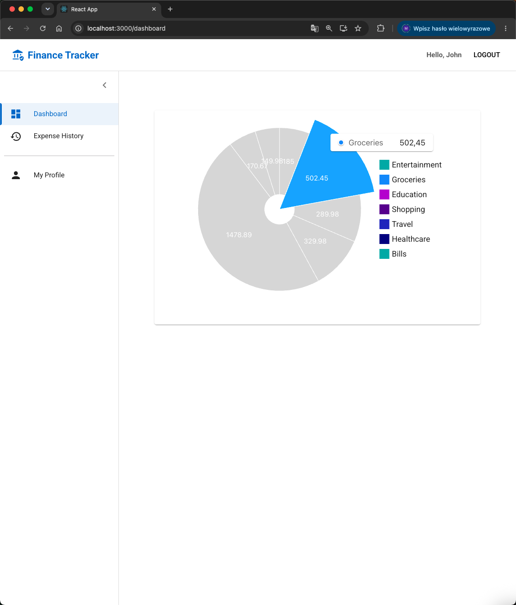
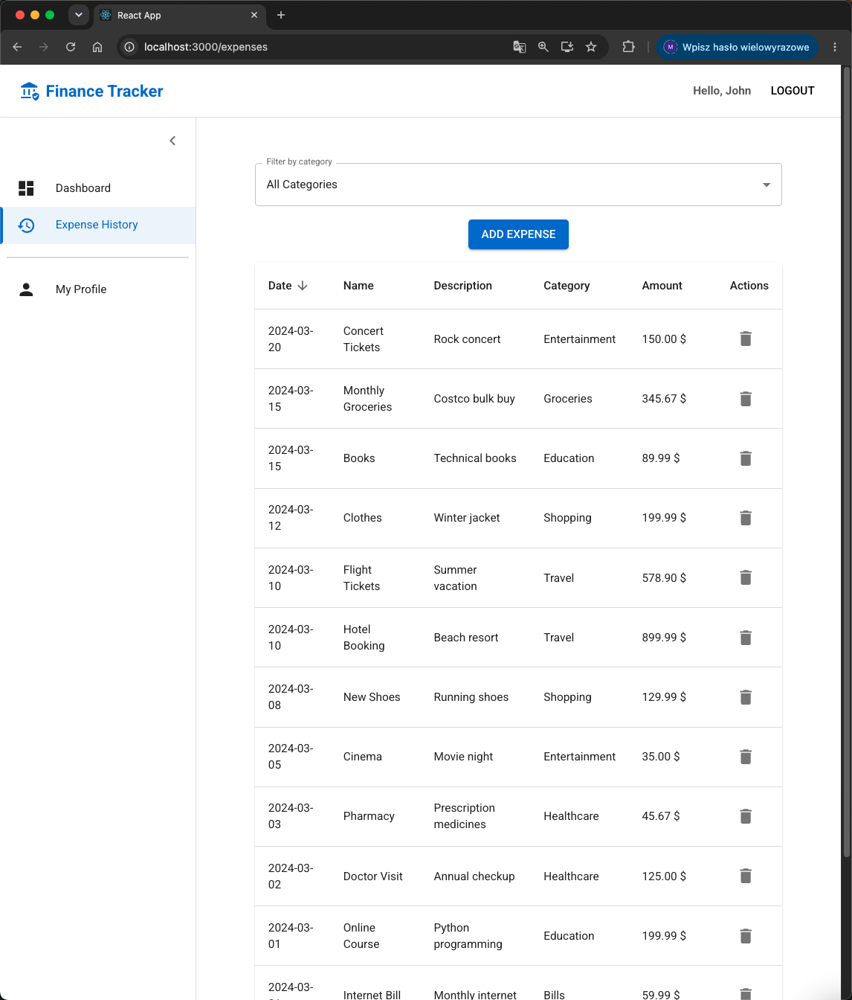
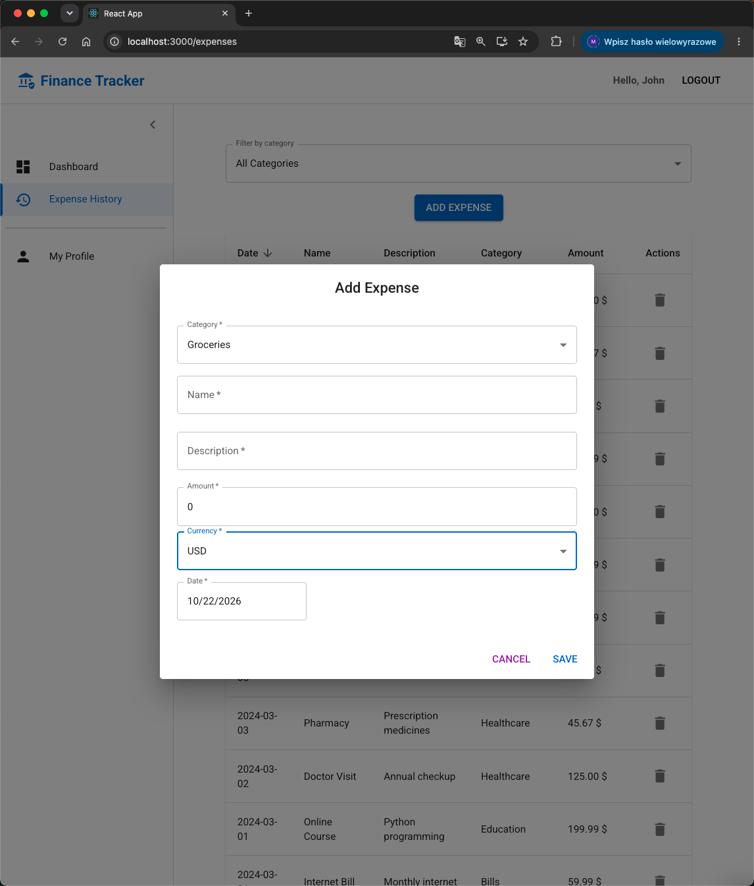

# Finance Tracker App

A full-stack web application for managing personal expenses and visualizing spending by category. The project combines a REST API built with FastAPI and a React frontend with TypeScript and Material UI.

## Features

- **User authentication** – user registration and login with JWT-based authentication.
- **Expense management** – add, view, filter, sort, and delete expenses.
- **Expense categories** – retrieve categories associated with the authenticated user.
- **Expense visualization** – pie chart displaying expense totals grouped by category.
- **Multi-currency support** – select a currency for each expense and set a default currency during registration.
- **Savings goals API** – create, list, sort, and delete savings goals.
- **Protected routes** – restrict access to application views to authenticated users.
- **API documentation** – interactive Swagger UI provided by FastAPI.

## Screenshots

### Dashboard



### Expense History



### Add Expense



## Tech Stack

### Backend

- Python
- FastAPI
- SQLAlchemy
- PostgreSQL
- JWT authentication
- Pytest
- Ruff
- mypy

### Frontend

- React
- TypeScript
- Material UI
- MUI X Charts
- Axios
- React Router

### Development and CI

- Docker
- Docker Compose
- GitHub Actions

## Project Structure

```text
Finance-Tracker-App/
├── backend/
│   ├── app/
│   │   ├── api/
│   │   ├── auth/
│   │   ├── categories/
│   │   ├── expenses/
│   │   ├── saving_targets/
│   │   └── users/
│   └── tests/
├── frontend/
│   └── src/
│       ├── api/
│       ├── components/
│       ├── context/
│       ├── hooks/
│       └── pages/
├── .github/
│   └── workflows/
├── docker-compose.yml
└── README.MD
```

## Getting Started

### Prerequisites

- Git
- Docker Desktop with Docker Compose

### Installation

Clone the repository:

```bash
git clone https://github.com/Jopus7/Finance-Tracker-App.git
cd Finance-Tracker-App
```

Build and start the application:

```bash
docker compose up --build
```

Once the services are running, open:

- **Frontend:** http://localhost:3000
- **API documentation:** http://localhost:8000/docs

The application uses Docker Compose to run the frontend, backend, and PostgreSQL database.

To stop the application, press `Ctrl+C`. If you started it in detached mode, run:

```bash
docker compose down
```

## Testing and Code Quality

The backend includes automated tests and static code quality checks.

Run the backend tests:

```bash
docker compose run --rm backend task test
```

Check code formatting:

```bash
docker compose run --rm backend task ci:format
```

Run linting:

```bash
docker compose run --rm backend task ci:lint
```

Run strict static type checking:

```bash
docker compose run --rm backend task typing
```

### Latest Local Check Results

- **Tests:** 11 passed.
- **Formatting:** 57 files passed the formatting check.
- **Linting:** All Ruff checks passed.
- **Type checking:** mypy passed in strict mode for 34 source files.

## Continuous Integration

A GitHub Actions workflow is configured to build the Docker Compose services and run backend formatting, linting, automated tests, and static type checks.

## Project Status

This is an actively developed portfolio project. Features and implementation details may evolve as development continues.
